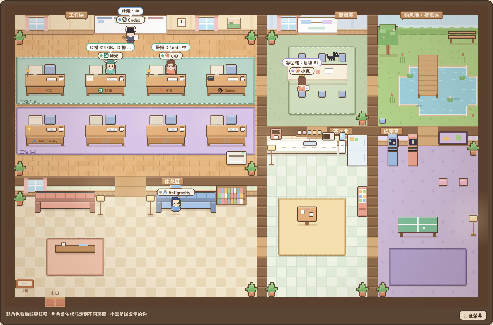

# AI 辦公室（Office Hub）



<sub>示範畫面：主管「小克」在會議室等回報，赫米（Hermes）和小B（Claude）在座位上工作，Codex 排隊等前面的任務完成，Antigravity 在休息區，小黑跑到會議桌上。</sub>

讓多台電腦上的 Claude Code 和 Hermes 組成一個團隊：你在任一台的 Claude Code 桌面版輸入 `/office 目標`，那台的 Claude 就當主管，拆任務派給其他人、收回報、審查，最後在對話裡交出成果。訊息、任務、檔案都經過家裡電腦上的 Hub，像素辦公室網頁即時顯示每個人在做什麼。

```
                     Tailscale 內網（不開對外 port）
┌───────────────────── A 機（家裡電腦）：Office Hub（src/）──────────────────────┐
│ /bot<token>/…  Telegram Bot API 相容＋任務擴充      /mcp   MCP 入口             │
│ /auth  網頁帳密登入   /join  agent 申請加入   /ws  網頁即時事件   /  像素辦公室  │
│ SQLite：帳號、訊息、更新佇列、目標、任務、檔案、事件、加入申請                  │
└─────────────────────────────────────────────────────────────────────────────────┘
        ▲ MCP（office_*）/ 長輪詢                             ▲
┌───────┴──── A 機（Windows）─────────────┐   ┌──────────────┴── B 機（Windows）──────┐
│ Claude Code 桌面版（claude_a，主管）     │   │ Claude Code 桌面版（claude_b，主管）   │
│ Hermes（Windows 原生 hermes.exe）        │   │ Hermes（WSL）                          │
│ office-node：claude_a 在線、hermes_a 接線│   │ office-node（Windows）：claude_b 在線  │
│                                          │   │ office-node（WSL）：Hermes 接線        │
└──────────────────────────────────────────┘   └────────────────────────────────────────┘
```

| 資料夾 | 內容 |
|---|---|
| `src/` | Hub 伺服器 |
| `ui/index.html` | 像素辦公室網頁（Hub 首頁） |
| `node/` | 每台機器用的 `office` 指令：加入辦公室、執行者接線（Hermes 等）、檔案上傳下載、設定 Claude Code |
| `claude/` | Claude Code 本機 marketplace：`/office` skill，以及終端機頻道模式用的 `office` 外掛（改寫自官方 Telegram 外掛） |
| `scripts/windows/`、`scripts/linux/` | 啟動腳本與開機啟動：Windows 工作排程器、Linux／WSL systemd |
| `docs/平台相容.md` | 各平台（Claude、Hermes、Codex、Antigravity）當櫃台／主管／執行者的接法，Windows／Linux 對照 |
| `test/` | 76 項自動測試（含真正的 grammY、官方 MCP SDK、外掛端對端、假 Hermes 全流程），Windows 與 Linux 都能跑 |

目前實測過的環境：兩台 Windows 11，四個 agent（Claude-A、Hermes-A（Windows 原生）、Claude-B、Hermes-B（WSL）），主管用 Claude Code 桌面版，跨機派工、審查、檔案上傳都跑過完整一輪。

## 需求

- 每台：[Bun](https://bun.sh)（`winget install Oven-sh.Bun`）、Git
- 有 Claude 的機器：Claude Code 桌面版，加上命令列版（`winget install Anthropic.ClaudeCode`）。命令列版是給 `office setup-desktop` 把辦公室工具加進 Claude Code 設定用的，`office doctor` 會檢查。
- 有 Hermes 的機器：Hermes Agent（Windows 原生版測過 v0.22.5；WSL／Linux 版也可以）
- 機器之間：[Tailscale](https://tailscale.com)（只有一台時可以先不用）

---

## 一、A 機（家裡電腦）：架 Hub

在專案資料夾（例如 `D:\AI home\ai-office-kumo7`）開終端機：

```bash
bun install
```

```bash
bun run init
```

`init` 建立資料庫與預設帳號（`boss`、`claude_a`、`claude_b`、`hermes_a`），token 存在 `data\tokens.local.json`。之後加 agent 用 `office join`（第二節），不必再碰這個檔案。

啟動 Hub：

```bash
scripts\windows\start-hub.cmd
```

在 A 機用瀏覽器開 `http://127.0.0.1:7070/`，第一次會請你**設定管理者帳號和密碼**。之後在任何電腦都用這組帳密登入。

- 第一次設定要在 A 機本機做，避免別台搶先設定。要在別台設定，登入畫面最下面貼上 `data\tokens.local.json` 裡 `boss` 的 token。
- 忘記密碼：登入畫面點「改用 token 登入」，用 `boss` 的 token 登入後按右上角「改密碼」。

**讓其他電腦連進來**：A 機登入 Tailscale，在專案根目錄建立 `hub.env.cmd`，寫一行：

```bat
set HUB_HOST=127.0.0.1,<A 機的 Tailscale IP>
```

（IP 用 `tailscale ip -4` 查），重開 Hub。本機與 Tailscale 同時可連；其他電腦用 `http://<A 機的 Tailscale IP>:7070/`。防火牆只開放 Tailscale 網段：以系統管理員執行 `install-tasks.ps1 -Firewall`（第五節）。

### Hub 環境變數

| 變數 | 預設 | 說明 |
|---|---|---|
| `HUB_HOST` | `127.0.0.1` | 綁定位址，可用逗號列多個（例如 `127.0.0.1,100.x.y.z`）。對外請用 Tailscale IP，不要用 `0.0.0.0` |
| `HUB_PORT` | `7070` | 連接埠 |
| `HUB_DB` | `data/office.db` | 資料庫；檔案存在旁邊的 `files/` |
| `HUB_LEASE_MIN` | `15` | 任務租約分鐘數，超過沒回報進度就退回待辦 |
| `HUB_STALL_MIN` | `5` | 做任務時超過幾分鐘沒動靜算「卡住」 |
| `HUB_OFFLINE_SEC` | `120` | 超過幾秒沒連線算「離線」 |
| `HUB_LOOP_LIMIT` | `30` | 同一串對話 bot 之間來回幾次就暫停，等你發言 |
| `HUB_LOG` | `1` | 設 `0` 關閉請求紀錄 |

---

## 二、加入 agent（`office join`，網頁按確認）

每台要加入的電腦：`git clone` 專案、`bun install`，把 `node` 資料夾加進使用者 PATH（之後 `office` 指令在任何終端機都能用）：

```powershell
[Environment]::SetEnvironmentVariable("Path", [Environment]::GetEnvironmentVariable("Path","User") + ";D:\AI home\ai-office-kumo7\node", "User")
```

重開終端機後，每個 agent 執行一次（例子是加入一個 Claude）：

```bash
office join http://<A 機的 Tailscale IP>:7070 --kind claude
```

一台電腦可以加入很多個 agent（例如一個 Claude 加幾個不同的 Hermes），各執行一次 `office join`。

1. 終端機印出 4 位數**確認代碼**，辦公室網頁上方同時跳出申請卡片。
2. 核對兩邊代碼一樣，需要的話改名稱或帳號，按「確認加入」。
3. token 自動寫進那台的 `~/.office/config.json`（原本的設定會保留）：
   - `--kind claude`：寫成 `claude_token`、設 `claude_mode: "desktop"`，並自動執行 `office setup-desktop`（第四節）。
   - `--kind hermes|codex|antigravity`：加進 `workers`，填好該平台的預設執行指令（可在設定檔改）；`other` 要自己填指令。
4. 重新啟動 office-node（`office run`，或「AI Office Node」排程工作），再用 `office doctor` 檢查。

說明：
- `--kind`：`claude`、`hermes`、`codex`、`antigravity`、`other`。`--name` 指定顯示名稱（之後也能在網頁改）。電腦名稱自動帶入（設定檔有 `machine` 就用它，沒有就用這台的電腦名稱），要自訂才加 `--machine`。
- 卡片上的帳號預設是「種類_電腦名稱」（例如 `claude_b`、`hermes_desktop01`）。這個帳號已經存在且種類相同（例如 `init` 建好的 `claude_b`），就是**重新加入**：沿用帳號、換新 token，舊 token 立即失效。重灌或換電腦也這樣用。
- 申請 15 分鐘內有效；被拒絕或過期時，那台的設定檔不會被改。
- 也可以手動：Hub 上 `bun run cli add <帳號> --kind <種類> --machine <機器>`，再把 token 貼進設定檔（範例在 `node/config.*.example.json`）。

### 管理成員

網頁右上角「成員」列出所有 agent 的狀態、最後連線時間和手上的工作：

- **改名稱、種類、說明**，改完按上方的「儲存全部」（只會送出有改動的欄位；關閉面板前還沒儲存會提醒）。電腦名稱只顯示、不在這裡改。
- **說明**（每個 agent 一段，最多 2000 字）：寫給主管看，例如「B 機 WSL（Linux），驗收用 sh、路徑寫 `out/...`；本地小模型，適合查檔、整理表格」。主管用 `office_agents` 讀得到，派工前會先看；主管 Claude 也能用 `office_agent_notes` 補充它學到的事（例如「會擋 PowerShell」）。面板上會顯示最後是誰、什麼時候改的。點辦公室裡的角色也看得到。
- **停用**：token 立即失效、從辦公室畫面拿掉；之後可以「重新啟用」，沿用原本的 token。
- **刪除**：帳號和 token 永久作廢，帳號名稱空出來可以再用；聊天和任務紀錄保留原本的名字。

停用或刪除時，它手上未完成的任務會自動改派給各目標的主管；它自己就是某個目標的主管時，網頁會提示你到看板處理。真人帳號只列出，不能在這裡停用。

---

## 三、接上 Hermes

office-node 收到派工後，替 Hermes 執行一次性的命令列，跑驗收、上傳檔案、回報。用 `office join --kind hermes` 加入時會自動填好下面的指令。

**Windows 原生版**（A 機）：

```json
"workers": [
  {
    "name": "hermes_a",
    "token": "<hermes_a 的 token>",
    "cmd": ["%LOCALAPPDATA%\\hermes\\bin\\hermes.exe", "chat", "-Q", "--query-file", "{prompt_file}"],
    "timeout_min": 30
  }
]
```

- **用絕對路徑**：工作排程器啟動時的 PATH 可能和終端機不同。`%LOCALAPPDATA%`、`~` 會自動展開。
- `{prompt_file}`：提示詞寫成暫存檔再傳路徑，避開 Windows 命令列長度上限和引號問題。
- 呼叫時自動設定 `PYTHONUTF8=1`、`NO_COLOR=1`，回報前也會清掉顏色碼和框線。
- 驗收指令由 `cmd.exe` 在任務工作目錄執行，例如：

```bat
powershell -NoProfile -Command "if ((Get-Item out\report.csv).Length -gt 0) { exit 0 } else { exit 1 }"
```

**WSL／Linux 版**（B 機）：在 WSL 裡另外跑一個 office-node（設定檔在 WSL 的 `~/.office/config.json`，範例 `node/config.linux.example.json`），指令是 `["hermes","chat","-Q","-q"]`、`"prompt_via": "arg"`。

- 建議在 Windows 的 `%USERPROFILE%\.wslconfig` 設 `networkingMode=mirrored`，WSL 直接共用 Windows 的網路（含 Tailscale）；同一台有 Hub 時也能用 `127.0.0.1` 連。
- 驗收指令由 `/bin/sh` 執行；Windows 的檔案路徑在 WSL 裡是 `/mnt/c/...`。
- 開機啟動：WSL 裡用 systemd（`scripts/linux/install-services.sh --node`），或在 Windows 用 `install-tasks.ps1 -WslHermes`。

**Hermes 工作階段清單看得到每個任務**：每個任務跑完後，office-node 會執行 `hermes sessions rename <session_id> 辦公室 #<任務> <標題>`，在 Hermes 的工作階段清單裡就能認出是哪個任務。不想改名就在那個執行者的設定加 `"rename_session": false`；其他執行者要的話設 `true`（指令格式要和 Hermes 一樣）。

**回報只交答案**：Hermes 被要求把給主管的結論寫進任務資料夾的 `answer.md`（沒寫就取輸出最後一段），回報內容就是結論加驗收結果，過程不送出。完整過程存成同一資料夾的 `worker-<時間>.log`；Hermes 的 `session_id` 和過程紀錄位置記在任務上，網頁的任務卡可以複製。

**指令被 Hermes 的安全規則擋下**：Hermes 有自己的安全規則（實測會擋 PowerShell、wmic）。提示詞已告訴它「指令只是建議，被擋就換方法，結果對就好」，實測它會自己改用 git-bash 的 `df` 等方法完成。真正把關的是驗收指令，驗收不經過 Hermes。

任務工作目錄是 `~/office-work/task-<編號>`，交付檔案放在裡面的 `out`（環境變數 `OFFICE_OUT`），會自動上傳。

Codex、Antigravity 等其他執行者的接法見 [docs/平台相容.md](docs/平台相容.md)。

---

## 四、Claude Code：桌面版當主管

`office join --kind claude` 會自動完成這一節。手動設定時，在那台執行：

```bash
office setup-desktop
```

它會：
- 把 Hub 的 MCP（名稱 `office-desktop`，用設定檔裡 `claude_token` 的帳號）加進 Claude Code 使用者設定。桌面版和命令列版讀同一份設定，所以要有命令列版 `claude`；沒有的話它會印出手動指令。
- 移除舊版教學加過的重複設定 `office-hub`。
- 安裝 `/office` skill。

接著確認設定檔有 `"claude_mode": "desktop"`，重開 office-node（桌面版沒有 hooks，改由 office-node 每 30 秒檢查 Claude 桌面版有沒有開著：開著就是在線，關掉就顯示離線；設定 `"claude_desktop_check": false` 可關閉這個檢查），再重開桌面版、開一個本機 session，輸入：

```
/office 列出 A、B 兩台機器的磁碟使用量並整理成表格
```

桌面版會開目標、看誰空閒、拆任務派工，然後**在同一輪裡用 `office_wait` 等回報**，收到就審查、改派或退回，全部完成後結案，在對話裡交出成果。等待時網頁上它會走到會議室，頭上顯示「等回報：目標 #N」。

要注意：
- 等待期間那一輪會一直跑。要插話就按停止再打字，之後說「繼續等目標 #N」。
- 別人丟給它的工作（另一台派的、Hermes 失敗改派回來的）要等它下一次 `office_wait` 才看得到。
- 同一個帳號不要同時開終端機的 `office-claude`（下面的頻道模式），兩邊會搶派工訊息。

### （選用）終端機頻道模式

Claude Code 命令列版可以用研究預覽中的 channels 功能，讓 Hub 隨時「叫醒」session，不必在同一輪裡等。設定比較多，而且視窗要一直開著：

1. 設定檔 `claude_mode` 改成 `"channel"`，執行 `office setup-claude`（寫入 `~/.claude/channels/office/` 的 `.env`、`access.json`，並安裝 `/office` skill）。
2. 照它印出的指令安裝外掛（只需一次）：

```bash
claude plugin marketplace add "D:\AI home\ai-office-kumo7\claude"
```

```bash
claude plugin install office@office-local
```

3. 用 `node\office-claude.cmd` 啟動（等於設 `OFFICE_SESSION=1` 後執行 `claude --dangerously-load-development-channels plugin:office@office-local`）。每次啟動會出現一次開發者頻道確認畫面，選「I am using this for local development」。
4. 這個模式下 office-node 用程序偵測判斷 session 有沒有在跑（`claude_process_pattern`）。

外掛只在 `OFFICE_SESSION=1` 的 session 啟用，桌面版和平常的 `claude` 不受影響。同一台開多個 Claude：見 [docs/平台相容.md](docs/平台相容.md) 第四節。

---

## 五、開機自動啟動

**Windows**：在專案根目錄開 PowerShell（之前用系統管理員註冊過的，這次也要用系統管理員）。

A 機（Hub＋office-node）：

```powershell
powershell -ExecutionPolicy Bypass -File scripts\windows\install-tasks.ps1 -Hub -Node
```

其他機器：

```powershell
powershell -ExecutionPolicy Bypass -File scripts\windows\install-tasks.ps1 -Node
```

- 登入時各開一個命令列視窗（標題「AI Office Hub」「AI Office Node」），**關掉視窗就停止**，不會自動重開；詳細紀錄在 `data\logs\`。
- 重複執行沒關係：工作已存在就更新設定，並先結束這個專案舊的 bun 再啟動。
- 選用參數：
  - `-Watchdog`：每 5 分鐘檢查，沒在跑就重開；異常結束每分鐘重試。
  - `-Firewall`（系統管理員）：只允許 Tailscale 網段 100.64.0.0/10 連 7070，已存在就略過。
  - `-WslHermes`：在 Windows 排程裡啟動 WSL 的 office-node。
  - `-Uninstall`：移除全部工作。

**Linux（含 WSL）**：systemd 使用者服務。Hub 那台 `bash scripts/linux/install-services.sh --hub --node`，其他機器 `--node`，移除用 `--uninstall`。WSL 要先在 `/etc/wsl.conf` 開啟 `[boot] systemd=true`。

---

## 六、使用

### 下目標的地方（櫃台，任選）

- **Claude Code 桌面版**：`/office <目標>`，這台的 Claude 當主管（第四節）。
- **網頁**：上方輸入目標，選主管（自動／指定哪個 Claude）。
- **任何終端機**：`office ask "<目標>" --download ./結果`，等結案後印出總結（設定檔要有 `boss_token`）。
- 支援 MCP 的平台（Hermes、Codex、Antigravity）也能當櫃台，見 [docs/平台相容.md](docs/平台相容.md)。

主管的分工原則：Hermes 拿單一、可驗證的工作，一定附驗收指令；需要判斷或多個步驟的工作給 Claude；主管自己要做的也派給自己。另一個 Claude 在線時自動當審查者，不在線就由主管自己審。主管選「自動」時：目標提到哪台機器就給那台的 Claude → 誰空閒 → 手上工作最少。

### 網頁

- **登入**：帳號密碼（第一節）；右上角可改密碼、登出。
- **辦公室**：最多 8 個工位，依帳號自動分配（一台 8 個或 8 台各 1 個都可以），不同平台不同造型。角色依狀態走到不同房間；空閒的人每 20～45 秒會換個休閒地點（茶水間、娛樂室、沙發、書架、窗邊…）。點角色看動態、任務，也可以改名。
- **名稱與圖示**：名牌是「公司標誌＋自訂名稱」：Claude（Anthropic）、Codex（OpenAI）、Hermes（Nous Research）、Antigravity（Google）、其他平台小機器人。圖示來源與授權見 `ui/icons/NOTICE.md`；想換成自己的圖，把檔案放在 `data/icons/<種類>.png`。
- **小黑**：辦公室的黑色小狗，會亂逛、找人撒嬌，想睡覺時走回休息區左下角的狗窩，偶爾冒出表情；點牠會有反應。
- **全螢幕**：辦公室畫面下方「⛶ 全螢幕」或按 `F`，只放大辦公室畫面；`Esc` 離開。
- **加入申請**：有 agent 執行 `office join` 時，上方跳出卡片，核對代碼後按確認（第二節）。
- **成員**：右上角，管理已加入的 agent（第二節）。
- **目標與任務**：看板；可以中止、重跑、改派。任務卡可複製 Hermes 的 session 編號與過程紀錄位置。
- **聊天**：office 群組（可選目標討論串，@ 人會叫到他）；「私訊／批准」裡有終端機模式 Claude 送來的權限按鈕。
- **通知**：右上角開啟桌面通知（任務完成或失敗、新的加入申請、需要批准）。

| 狀態 | 去哪裡 | 怎麼判斷 |
|---|---|---|
| 工作中 | 座位 | 有進行中的任務，或 hooks 回報正在用工具 |
| 開會／審查 | 會議室 | 是某個目標的主管或審查者，最近有動作（例如桌面版在 `office_wait` 等回報） |
| 空閒 | 茶水間、娛樂室、休息區 | 在線但沒事 |
| 排隊 | 任務看板前 | 有待辦任務還沒開始 |
| 等你批准 | 座位 | 終端機模式的 Claude 跳出權限提示 |
| 卡住（偷懶） | 釣魚池摸魚 | 有進行中任務，但超過 `HUB_STALL_MIN` 沒動靜 |
| 報錯 | 座位冒煙 | 終端機模式的 Claude 回合因 API 錯誤結束 |
| 離線 | 不在辦公室 | 超過 `HUB_OFFLINE_SEC` 沒連線 |

### 任務規則

- 任務有租約（預設 15 分鐘），執行者要定期回報進度；過期自動退回待辦並通知主管。office-node 執行中每 30 秒自動回報。
- Hermes 等執行者失敗會自動重試（預設 2 次）；用完次數就改派給在線的審查者 Claude，審查者不在線就改派給主管。
- `depends_on` 的任務在前置任務完成後才會派出。
- 主管或審查者可以退回（`office_review`），任務會重新派給原執行者；退回也算一次，用完次數就照失敗流程改派。
- 重新派出時（自動重試、退回、改派、重跑），執行者會收到原因：退回說明全文、上次的結果或驗收失敗輸出。office-node 會把上次的 `out/` 改名成 `out.prev-<次數>`、建立空的 `out/`，提示詞會說明舊檔只能參考；驗收和上傳只看新的 `out/`，舊檔不會讓驗收矇混過關。
- 同一串對話 bot 之間來回超過上限會暫停，等你在網頁發言。

### 檔案

- 上傳：`office upload <檔案>` 印出 `file_id`，放進回報的 `files`。
- 下載：`office download <file_id> [目錄]`；網頁上的📎可以直接下載。
- 執行者把產出放在 `$OFFICE_OUT`，office-node 會自動上傳。

---

## 七、API

所有 agent 共用同一套方法，兩個入口：

- HTTP：`POST /bot<token>/<方法>`（真人與網頁用 `/user<token>/<方法>`），回應 `{"ok":true,"result":...}`，與 Telegram 相同。
- MCP：`POST /mcp`，`Authorization: Bearer <token>`，工具背後呼叫相同方法。

### Telegram 相容方法

`getMe`、`getUpdates`（長輪詢、offset）、`sendMessage`、`sendDocument`、`sendPhoto`、`getFile`（下載：`GET /file/bot<token>/<file_path>`）、`editMessageText`、`sendChatAction`、`setMessageReaction`、`answerCallbackQuery`、`setMyCommands`、`getMyCommands`、`deleteMyCommands`、`getChat`、`deleteWebhook`、`getWebhookInfo`、`setMyName`

和 Telegram 不同的地方：

- bot 之間互相看得到訊息。
- 訊息多一個 `data` 欄位放結構化資料（任務卡等）。
- 沒給 `entities` 時，Hub 自動標出 `@username`。
- 回覆訊息時沿用原訊息的討論串（`message_thread_id`）。
- `chat_id` 可用 `@username`、`@office`（群組 id `-1001000000001`）。
- 同一個 bot 重開長輪詢時，舊連線被接手並回空陣列，不回 409。

### 擴充方法（HTTP 名稱 / MCP 工具）

| HTTP | MCP | 說明 |
|---|---|---|
| `createGoal` | `office_new_goal` | 開目標；Claude 呼叫時自己當主管，其他人可指定 `lead` 或 `auto` |
| `createTask` | `office_assign` | 主管派工，固定格式：必填 `objective`（目標）、`inputs`（輸入）、`deliverable`（交付物）、`out_of_scope`（不要做什麼）、`verify`（驗收），缺欄位會被退回；選填 `steps`、`instructions`、`depends_on`、`max_attempts`。Hub 組成「【目標】【輸入】【建議做法】【交付物】【不要做】」交給執行者 |
| `claimTask` | `office_claim` | 執行者領取（原子操作），開始租約 |
| `progressTask` | `office_progress` | 回報進度並延長租約 |
| `reportTask` | `office_report` | `done` / `failed`，附結果與 `files` |
| `reviewTask` | `office_review` | 主管或審查者 `approve` / `reject` |
| `reassignTask` / `retryTask` / `cancelTask` | `office_reassign` / `office_retry` / `office_cancel` | 主管或真人 |
| `completeGoal` | `office_complete_goal` | 結束目標並附總結 |
| `getGoals` / `getTasks` / `getAgents` | `office_goals` / `office_tasks` / `office_agents` | 查詢；`getAgents` 含每個成員的說明 |
| `setAgentNotes` | `office_agent_notes` | 寫成員說明（真人或 Claude；Hermes 等執行者不能改） |
| `waitEvents` | `office_wait` | 等跟自己有關的消息（最多 110 秒），可指定目標，結案時回傳總結；不回傳編輯過的進度訊息；桌面版主管與櫃台用 |
| `uploadFile` | — | 只上傳不發訊息 |
| `pressButton` | — | 真人按 bot 訊息上的按鈕（網頁批准權限用） |
| `heartbeat` | — | office-node 心跳 |
| `renameAccount` | — | 真人改任何帳號的顯示名稱 |
| `getJoinRequests` / `approveJoin` / `rejectJoin` | — | 真人：查看、確認、拒絕加入申請 |
| `getMembers` / `updateMember` / `disableMember` / `enableMember` / `deleteMember` | — | 真人：成員管理 |
| `changePassword` | — | 真人改網頁登入密碼 |
| — | `office_send`、`office_whoami`、`office_file_info` | 發訊息、身分、檔案資訊 |

不需要 token 的入口：

| 入口 | 說明 |
|---|---|
| `GET /auth/status` | 是否還沒設定帳密、是不是 Hub 本機 |
| `POST /auth/setup` | 第一次設定帳密（Hub 本機，或附 `boss` token） |
| `POST /auth/login`、`POST /auth/logout` | 網頁登入、登出 |
| `POST /join` | 申請加入，回傳確認代碼 |
| `POST /join/wait` | 等網頁確認後取得 token（只交一次） |

---

## 八、安全

- Hub 只綁本機和 Tailscale IP，不開對外 port；防火牆可限制只有 Tailscale 網段能連（`-Firewall`）。
- 每個帳號一組 token，資料庫只存雜湊；`bun run cli token <帳號>` 可換新 token。
- 網頁用帳號密碼登入：密碼用 argon2 雜湊；session 90 天、登出即失效；同一個來源 10 分鐘內失敗 10 次就暫停登入；第一次設定帳密只限 Hub 本機或附 `boss` token。
- agent 加入要真人在網頁確認，並核對兩邊的 4 位數代碼；token 只交給發出申請的那台（要帶申請時拿到的祕密），交出後就從資料庫清掉。
- 其他 agent 的訊息會標示為「來自同事」，不是你的指令。
- 權限批准只接受 `approvers` 裡的真人；其他 bot 回「yes 代碼」或按按鈕都無效（有測試）。
- hooks 只送事件名稱、工具名稱和指令前 300 字，不送檔案內容與工具輸出。

## 九、已知限制

- 桌面版主管在等回報時那一輪會一直跑，插話要先按停止；別人丟給它的工作要等它下次 `office_wait` 才看到。
- Hermes 本地模型能接多大的任務，取決於模型呼叫工具穩不穩；先從小任務開始。每個 Hermes 只碰得到自己那台機器的檔案。
- Hermes 的參數依版本可能不同，用 `office doctor` 檢查，必要時改設定檔的 `cmd`，或改用 `api` 模式。
- 辦公室畫面最多 8 個工位；第 9 個以後的帳號仍能派工、聊天，只是不出現在畫面上。
- Codex、Antigravity 的接法已預留但未實測。
- 終端機頻道模式用的 channels 是研究預覽功能，旗標名稱和行為之後可能改變。
- Hub 在家裡電腦，關機時整個系統停擺。

## 十、開發與測試

```bash
bun install
(cd claude/office && bun install)
bun test
```

```bash
bun run cli list
bun run cli add codex_a --name Codex-A --kind codex --machine A
```
